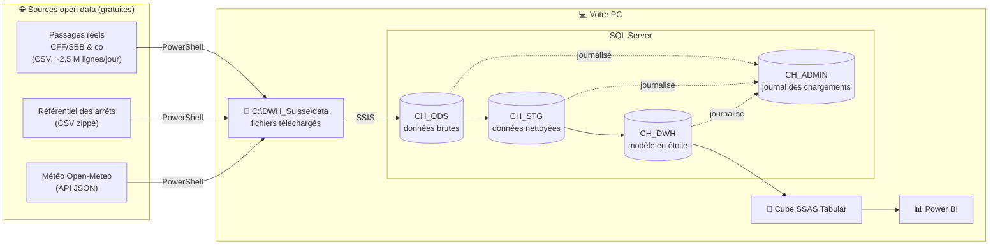

# DWH Suisse : ponctualité des transports publics suisses

Projet de formation **SSIS, SQL Server, SSAS et Power BI**, construit comme un projet d'entreprise : données ouvertes réelles, chargement en plusieurs couches (ODS, STG, DWH), master package, journalisation, historisation et cube.

> **La question métier :** *« Les trains, bus et trams suisses sont-ils à l'heure ? Où, quand, chez quel opérateur ? La météo joue-t-elle un rôle ? »*

Tout est **gratuit** : SQL Server Developer, Visual Studio Community, Power BI Desktop et des données open data. Aucune extension payante (pas de ZappySys) : uniquement les composants natifs de SSIS.

---

## Le projet en une image



Le **master package SSIS** (`00_MASTER.dtsx`) enchaîne automatiquement toutes ces étapes.

---

## Pour qui, et comment lire ce dépôt ?

| Vous êtes... | Commencez par |
|---|---|
| **Non technique / curieux** | Ce README, puis le [glossaire](docs/09_Glossaire.md) et l'[architecture expliquée simplement](docs/02_Architecture.md) |
| **Prêt à installer** | [Guide d'installation pas à pas](docs/01_Installation.md) |
| **En apprentissage SSIS / BI** | La [roadmap](ROADMAP.md) : chaque phase a ses objectifs, ses manipulations et ses exercices |

### Toute la documentation

| # | Document | Contenu |
|---|---|---|
| 1 | [Installation](docs/01_Installation.md) | Logiciels à installer, réglages, premier lancement |
| 2 | [Architecture](docs/02_Architecture.md) | Les couches ODS / STG / DWH / cube, avec des analogies |
| 3 | [Sources de données](docs/03_Sources_de_donnees.md) | D'où viennent les données, leur format, leurs pièges |
| 4 | [Modèle de données](docs/04_Modele_de_donnees.md) | Schéma en étoile, dictionnaire des tables, historisation |
| 5 | [Packages SSIS](docs/05_Packages_SSIS.md) | Chaque package expliqué, master package, paramètres |
| 6 | [Cube SSAS](docs/06_Cube_SSAS.md) | Modèle tabulaire, mesures DAX, sécurité, déploiement |
| 7 | [Power BI](docs/07_Power_BI.md) | Connexion au cube et rapport proposé |
| 8 | [Exploitation et dépannage](docs/08_Exploitation_et_depannage.md) | Lancer, surveiller, résoudre les erreurs courantes |
| 9 | [Glossaire](docs/09_Glossaire.md) | Tous les termes expliqués simplement |
| 10 | [Bonnes pratiques](docs/10_Bonnes_pratiques.md) | Conventions appliquées (à compléter avec celles de l'entreprise) |
| 11 | [Exercices](docs/11_Exercices.md) | Pour monter en compétence en refaisant les choses soi-même |

---

## Démarrage rapide (résumé)

> Le détail de chaque étape, captures et pièges compris, est dans [docs/01_Installation.md](docs/01_Installation.md).

1. **Installer** SQL Server 2022 Developer (moteur, Integration Services, Analysis Services en mode *Tabular*), SSMS, le pilote OLE DB 18, Visual Studio 2022 Community avec les extensions SSIS et Analysis Services, et Power BI Desktop.
2. **Cloner** le dépôt dans `C:\DWH_Suisse\DWH-Suisse` :
   ```bash
   git clone https://github.com/quen9669/DWH-Suisse C:\DWH_Suisse\DWH-Suisse
   ```
3. **Préparer** le PC et créer les bases (PowerShell **en administrateur**) :
   ```powershell
   cd C:\DWH_Suisse\DWH-Suisse\scripts
   Set-ExecutionPolicy -Scope CurrentUser RemoteSigned
   .\Initialize-Environment.ps1
   .\Deploy-Database.ps1
   ```
4. **Charger les données** : ouvrir `ssis\DWH_Suisse_ETL\DWH_Suisse_ETL.dtproj` dans Visual Studio, faire un clic droit sur `00_MASTER.dtsx`, puis choisir *Execute Package*.
5. **Créer le cube** : ouvrir `ssas\DWH_Suisse_Cube\DWH_Suisse_Cube.smproj`, puis faire un clic droit sur le projet et choisir *Deploy*.
6. **Analyser** : dans Power BI Desktop, *Obtenir les données > Analysis Services > `localhost` > Connexion active*.

---

## Structure du dépôt

```
DWH-Suisse/
├── README.md                  ← vous êtes ici
├── ROADMAP.md                 ← plan de montée en compétence, phase par phase
├── docs/                      ← documentation détaillée (11 guides)
├── sql/                       ← scripts SQL : création des bases, tables, procédures
│   ├── 01_Bases_de_donnees.sql   4 bases + schémas
│   ├── 02_ADMIN.sql              journal des lots / étapes / fichiers
│   ├── 03_ODS.sql                tables brutes
│   ├── 04_STG.sql                tables de préparation + règles de qualité
│   ├── 05_DWH_Tables.sql         dimensions et faits
│   ├── 06_DWH_Referentiels.sql   calendrier, heures, cantons, modes...
│   ├── 07_DWH_Procedures.sql     chargement des dimensions (SCD1/SCD2) et des faits
│   ├── 08_DWH_Vues_Cube.sql      vues lues par le cube
│   ├── 09_Securite.sql           droits des comptes de service
│   ├── 10_Job_SQLAgent.sql       planification quotidienne (phase 5)
│   └── 99_Controles.sql          requêtes de contrôle après chargement
├── scripts/                   ← PowerShell : préparation du PC, téléchargements, cube
├── ssis/DWH_Suisse_ETL/       ← projet Visual Studio SSIS (9 packages)
├── ssas/DWH_Suisse_Cube/      ← projet Visual Studio SSAS Tabular
├── powerbi/                   ← emplacement du rapport Power BI (.pbix)
└── tools/                     ← générateurs Python ayant produit les projets SSIS/SSAS
```

---

## Ce qui rend ce projet « réaliste »

| Notion d'entreprise | Où la voir |
|---|---|
| Architecture en couches ODS → STG → DWH | 4 bases SQL distinctes |
| Master package + packages enfants | `00_MASTER.dtsx` appelle 8 packages |
| Paramètres de projet, connexions partagées | `Project.params`, `CM_*.conmgr` |
| Boucle sur des fichiers, archivage | `21_ODS_Istdaten.dtsx` (Foreach Loop + File System Task) |
| Data Flow natif (fichier plat → table) | packages `20_` et `21_` |
| Données JSON sans composant payant | `22_ODS_Meteo` + `OPENJSON` en STG |
| Journalisation des lots, étapes, fichiers | base `CH_ADMIN` |
| Reprise après incident, chargements rejouables | `etl.FileLog`, suppression/insertion par jour |
| Contrôle qualité, table de rejets | `stg.Istdaten_Rejet` |
| Historisation SCD type 2 | `dim.Station` |
| Membres déduits (*inferred members*) | `etl.usp_Load_DimStation_Inferred` |
| Gros volumes (millions de lignes) | index *columnstore* sur l'ODS et les faits |
| Cube tabulaire, DAX avancé, sécurité par ligne | `Model.bim` |
| Planification | job SQL Server Agent |

---

## État du projet : ce qui a été vérifié

Transparence sur la façon dont ce dépôt a été produit :

- ✅ **Sources de données** : URL, format (séparateur `;`, encodage UTF-8, 22 et 55 colonnes) et API météo vérifiés en ligne le 27/10/2026.
- ✅ **Scripts PowerShell** : syntaxe validée, et la détection des liens de téléchargement a été testée sur les pages réelles du portail.
- ✅ **Fichiers SSIS/SSAS** : XML et JSON bien formés, lignage des colonnes du Data Flow cohérent.
- ⚠️ **Pas encore exécuté de bout en bout** : la machine de création n'avait ni SQL Server ni Visual Studio. Les scripts SQL n'ont donc pas encore tourné sur un vrai serveur, et les packages SSIS (écrits par programme, voir `tools/`) n'ont pas encore été ouverts dans le concepteur. Au premier lancement, des ajustements mineurs sont possibles (avertissement de métadonnées, propriété à rafraîchir). La procédure à suivre est décrite dans [docs/08_Exploitation_et_depannage.md](docs/08_Exploitation_et_depannage.md).

---

## Licence des données

- Données transport : [opentransportdata.swiss](https://opentransportdata.swiss) (conditions d'utilisation de la plateforme open data suisse).
- Météo : [Open-Meteo](https://open-meteo.com) (CC BY 4.0, usage non commercial gratuit).
