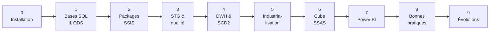

# Roadmap : de l'installation au rapport Power BI

Ce projet se parcourt en **10 phases**. Chacune a :
- 🎯 un **objectif** clair,
- 🛠️ des **manipulations** à faire,
- 🧠 ce que vous aurez **appris** (les compétences visées en entreprise),
- ✅ un **critère de fin** pour savoir que la phase est terminée.

Cochez les cases au fur et à mesure (dans GitHub : modifiez ce fichier et remplacez `[ ]` par `[x]`).

Rythme indicatif : environ une phase par semaine en soirée. Les phases 2, 4 et 6 sont les plus denses.

---

## Phase 0 : installation

🎯 Avoir un PC prêt, avec tous les outils gratuits.

🛠️ Suivre [docs/01_Installation.md](docs/01_Installation.md) :
- [ ] SQL Server 2022 **Developer** (moteur + Integration Services + Analysis Services en mode Tabular)
- [ ] SSMS
- [ ] Pilote Microsoft OLE DB 18 pour SQL Server
- [ ] Visual Studio 2022 Community + extensions *Integration Services Projects* et *Analysis Services Projects*
- [ ] Power BI Desktop
- [ ] Git, puis clonage du dépôt dans `C:\DWH_Suisse\DWH-Suisse`
- [ ] `Initialize-Environment.ps1` exécuté sans erreur

🧠 Vous saurez installer une plateforme BI Microsoft complète (savoir utile pour dialoguer avec les équipes infrastructure).

✅ `Initialize-Environment.ps1` affiche `[OK]` pour le moteur SQL et Analysis Services.

---

## Phase 1 : créer les bases et comprendre l'ODS

🎯 Créer les 4 bases et comprendre le rôle de chacune.

🛠️
- [ ] Lancer `scripts\Deploy-Database.ps1`
- [ ] Dans SSMS, parcourir les bases `CH_ADMIN`, `CH_ODS`, `CH_STG`, `CH_DWH`
- [ ] Lire [docs/02_Architecture.md](docs/02_Architecture.md) et [docs/03_Sources_de_donnees.md](docs/03_Sources_de_donnees.md)
- [ ] Lancer à la main `Get-ServicePoints.ps1` puis ouvrir le CSV dans Excel ou VS Code

🧠 Différence entre zone brute (ODS), zone de préparation (STG) et entrepôt (DWH) ; pourquoi l'ODS stocke tout en texte ; colonnes d'audit.

✅ Vous savez expliquer à un collègue non technique pourquoi il y a 4 bases.

---

## Phase 2 : comprendre et exécuter les packages SSIS

🎯 Ouvrir le projet SSIS, comprendre le master package et lancer un premier chargement complet.

🛠️
- [ ] Ouvrir `ssis\DWH_Suisse_ETL\DWH_Suisse_ETL.dtproj` dans Visual Studio
- [ ] Vérifier les **paramètres du projet** (`Project.params`) : `ScriptsFolder`, `DataFolder`, `ServerName`
- [ ] Ouvrir chaque package et lire sa description (fenêtre Propriétés)
- [ ] Exécuter `00_MASTER.dtsx` (clic droit > *Execute Package*), puis suivre l'onglet *Progress*
- [ ] Exécuter `99_Controles.sql` dans SSMS : lots, étapes, fichiers, réconciliation
- [ ] Poser un **point d'arrêt** (breakpoint) sur la boucle Foreach de `21_ODS_Istdaten` et observer la variable `User::FilePath` à chaque tour
- [ ] Ajouter une **Data Viewer** sur le chemin du Data Flow de `20_ODS_ServicePoints`

🧠 Control Flow et Data Flow ; master package et *Execute Package Task* ; paramètres de projet et de package ; variables et expressions ; Foreach Loop ; File System Task ; Execute Process Task ; gestionnaire d'événements `OnError` ; débogage.

✅ Un lot en statut `Succès` dans `CH_ADMIN.etl.vw_Suivi_Lots` et des millions de lignes dans `CH_DWH.fact.StopEvent`.

---

## Phase 3 : zone de préparation (STG) et qualité des données

🎯 Comprendre comment le texte brut devient une donnée fiable.

🛠️
- [ ] Lire `sql\04_STG.sql` : conversions `TRY_CONVERT`, règles de rejet, doublons, calcul des retards
- [ ] Consulter `CH_STG.stg.Istdaten_Rejet` : quels motifs ? combien ?
- [ ] Lire comment le JSON météo est « déplié » avec `OPENJSON` (procédure `stg.usp_Load_Meteo`)
- [ ] Exercice : ajouter une règle de rejet (voir [docs/11_Exercices.md](docs/11_Exercices.md), exercice 3)

🧠 Typage, règles de qualité, gestion des rejets, idempotence (pouvoir rejouer sans doublon), traitement du JSON en SQL.

✅ Vous savez expliquer pourquoi le nombre de lignes ODS = STG + rejets (requête 5 de `99_Controles.sql`).

---

## Phase 4 : l'entrepôt (DWH), le modèle en étoile et l'historisation

🎯 Maîtriser dimensions, faits, clés de substitution et SCD.

🛠️
- [ ] Lire [docs/04_Modele_de_donnees.md](docs/04_Modele_de_donnees.md)
- [ ] Lire `sql\07_DWH_Procedures.sql` : SCD1 (`MERGE`), **SCD2** (`dim.Station`), membres déduits, chargement des faits « supprimer puis insérer »
- [ ] Simuler un changement SCD2 (exercice 4) et observer la nouvelle version de la gare
- [ ] **Refaire en SSIS pur** le chargement de `dim.Operator` avec un *Lookup* et un *Conditional Split* (exercice 5)

🧠 Modèle en étoile, clés techniques et clés métier, membres inconnus (-1), SCD types 1 et 2, *inferred members*, tables de faits *columnstore*.

✅ Requête 7 de `99_Controles.sql` : vous voyez une gare avec 2 versions.

---

## Phase 5 : industrialiser (déploiement et planification)

🎯 Faire tourner le chargement tout seul, chaque matin, comme en production.

🛠️
- [ ] Créer le catalogue **SSISDB** (SSMS > *Integration Services Catalogs* > *Create Catalog*)
- [ ] Déployer le projet (Visual Studio > clic droit sur le projet > *Deploy*), dans le dossier `DWH_Suisse`
- [ ] Créer un **environnement** SSISDB `DEV` avec des variables mappées aux paramètres du projet
- [ ] Exécuter `sql\09_Securite.sql`, puis `sql\10_Job_SQLAgent.sql`
- [ ] Lancer le job à la main, puis consulter le rapport *All Executions* de SSISDB

🧠 Modèle de déploiement par projet, catalogue SSISDB, environnements, niveaux de journalisation, SQL Server Agent, comptes de service.

✅ Le job SQL Agent s'exécute avec succès sans Visual Studio ouvert.

---

## Phase 6 : le cube SSAS Tabular

🎯 Publier un modèle sémantique prêt pour Power BI.

🛠️
- [ ] Ouvrir `ssas\DWH_Suisse_Cube\DWH_Suisse_Cube.smproj` (choisir *Integrated workspace*)
- [ ] Explorer les tables, relations, hiérarchies et les 20 mesures DAX ([docs/06_Cube_SSAS.md](docs/06_Cube_SSAS.md))
- [ ] Déployer sur `localhost` (clic droit > *Deploy*)
- [ ] Passer le paramètre de projet SSIS `TraiterCube` à `true` : le master package traitera le cube
- [ ] Tester le rôle `Lecteurs Suisse romande` (*Analyze in Excel* > *Role*)
- [ ] Exercice : créer une **partition par mois** sur la table Passages (exercice 8)

🧠 Modèle tabulaire, relations, hiérarchies, DAX (`CALCULATE`, `DIVIDE`, `DATEADD`, `TREATAS`), sécurité par ligne (RLS), traitement et partitions.

✅ La base `DWH_Suisse_Cube` est visible dans SSMS (connexion *Analysis Services*).

---

## Phase 7 : le rapport Power BI

🎯 Restituer les résultats à un public métier.

🛠️
- [ ] Connexion active (*live*) au cube ([docs/07_Power_BI.md](docs/07_Power_BI.md))
- [ ] Construire les 4 pages proposées : Vue d'ensemble, Carte, Opérateurs et lignes, Météo
- [ ] Enregistrer le fichier dans `powerbi\DWH_Suisse.pbix` et le pousser sur GitHub

🧠 Connexion live vs import, design d'un rapport, cartes, segments, info-bulles.

✅ Vous pouvez répondre : *« Quelle est la tranche horaire la moins ponctuelle à Zurich ? »*

---

## Phase 8 : appliquer les bonnes pratiques de l'entreprise

🎯 Aligner le projet sur les standards utilisés au travail.

🛠️
- [ ] Fournir la page des bonnes pratiques (prévu)
- [ ] Comparer avec [docs/10_Bonnes_pratiques.md](docs/10_Bonnes_pratiques.md) et lister les écarts
- [ ] Renommer et réorganiser (préfixes de packages, nommage des tâches, schémas, journalisation...)

✅ Le projet respecte la page des bonnes pratiques.

---

## Phase 9 : évolutions pour aller plus loin

Choisissez selon vos envies :

- [ ] **Horaires théoriques GTFS** : ajouter la source GTFS (fichier zip de plusieurs CSV liés) pour comparer l'offre planifiée à l'offre réelle
- [ ] **Historique long** : charger un mois complet depuis les archives mensuelles d'opentransportdata.swiss
- [ ] **Chargement incrémental du cube** : partitions par mois avec traitement de la seule partition du mois courant
- [ ] **Data Flow 100 % SSIS** : remplacer une procédure STG par un Data Flow (*Derived Column*, *Data Conversion*, *Conditional Split*, *Lookup*)
- [ ] **Tests automatisés** : tests unitaires SQL avec tSQLt
- [ ] **GitHub** : branches par fonctionnalité, *pull requests*, tableau de suivi (*Projects*)
- [ ] **Tableau de bord qualité** : page Power BI sur les rejets et les durées de chargement (base `CH_ADMIN`)
