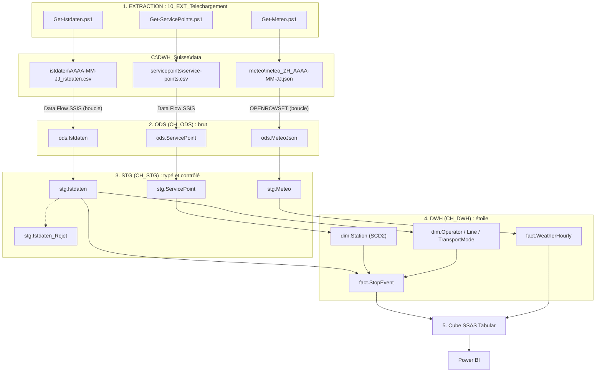
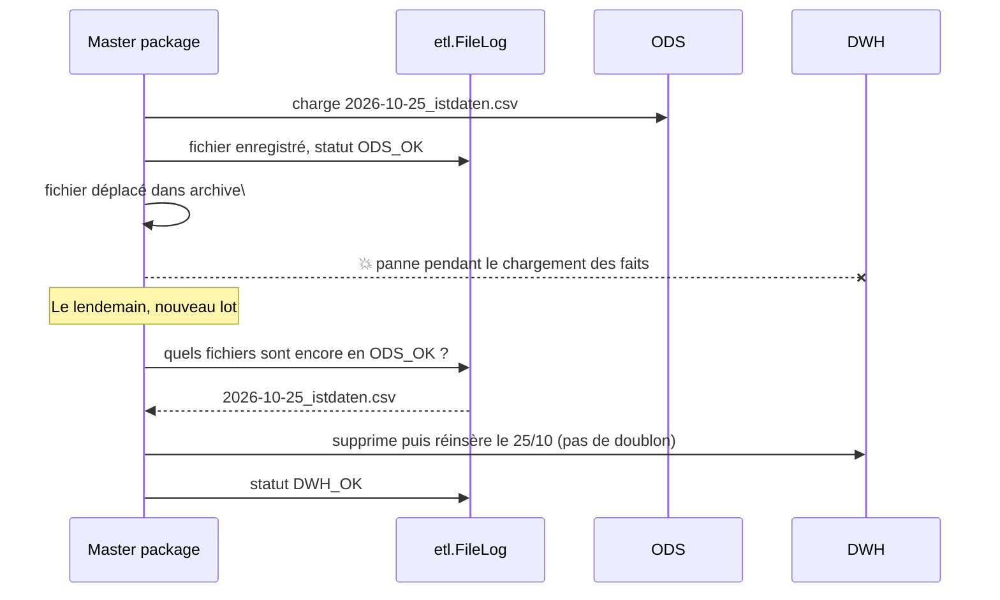

# 2. Architecture expliquée simplement

## L'analogie de l'entrepôt logistique

Imaginez une entreprise qui reçoit chaque jour des camions de marchandises :

| Étape logistique | Dans le projet | Rôle |
|---|---|---|
| 🚚 **Livraison** | Scripts PowerShell | On va chercher les colis (fichiers) chez les fournisseurs (sites open data) |
| 📦 **Quai de réception** | Base **CH_ODS** | On décharge les colis **sans les ouvrir**, avec une étiquette « reçu le... par le camion n°... » |
| 🔧 **Atelier de tri** | Base **CH_STG** | On ouvre, on vérifie, on jette les colis abîmés (rejets), on met chaque objet au bon format |
| 🏬 **Entrepôt rangé** | Base **CH_DWH** | Les objets sont rangés par rayons (dimensions) et l'inventaire est tenu (faits) |
| 🪟 **Vitrine** | **Cube SSAS** | Une présentation prête à l'emploi : les totaux sont précalculés, les noms sont clairs |
| 🛍️ **Client** | **Power BI** | Le client consulte la vitrine, sans jamais entrer dans l'entrepôt |
| 📋 **Registre du chef d'entrepôt** | Base **CH_ADMIN** | Qui a livré quoi, quand, combien de colis, quels incidents |
| 👷 **Chef d'équipe** | **Master package SSIS** | Donne les ordres dans le bon ordre et note tout dans le registre |

## Le flux complet

## Pourquoi plusieurs couches ? (questions fréquentes)

**« Pourquoi ne pas charger directement les fichiers dans l'entrepôt ? »**
Parce qu'en cas d'erreur, on veut pouvoir **recommencer sans re-télécharger**. L'ODS garde une copie fidèle de ce qui a été reçu. Si une règle métier change (par exemple la définition d'un retard), on rejoue STG → DWH à partir de l'ODS.

**« Pourquoi l'ODS stocke-t-il tout en texte ? »**
Si un fichier contient une date mal formée, un chargement typé planterait et l'on perdrait toute la journée. En texte, **tout entre**. Le tri se fait ensuite, en STG, avec une trace des lignes rejetées et du motif.

**« Pourquoi vider la zone STG à chaque fois ? »**
C'est une zone de passage, comme un plan de travail que l'on débarrasse. Seules les tables de rejets sont gardées, pour analyse.

**« À quoi sert le cube si on a déjà l'entrepôt ? »**
L'entrepôt est fait pour stocker, le cube pour **répondre vite** : il précalcule et compresse, il porte les définitions officielles des indicateurs (une seule formule du « taux de ponctualité » pour tous les rapports) et il gère la sécurité (qui voit quoi).

## Les choix techniques, et pourquoi

| Choix | Raison |
|---|---|
| **Téléchargement en PowerShell** (et non dans SSIS) | SSIS ne sait pas télécharger nativement un fichier HTTP sans script C# ou composant payant. PowerShell est natif et lisible. SSIS orchestre les scripts avec l'*Execute Process Task*. |
| **Data Flow SSIS pour les CSV** | C'est le cœur du métier SSIS : source fichier plat, colonnes dérivées, comptage, destination en chargement rapide. |
| **JSON lu par SQL Server** (`OPENROWSET` + `OPENJSON`) | SSIS n'a pas de source JSON native (c'est ce que vendent ZappySys et d'autres). SQL Server sait le faire gratuitement. |
| **Transformations STG/DWH en procédures stockées** | Pattern très courant en entreprise (« ELT ») : SSIS orchestre, SQL Server calcule. Plus rapide sur des millions de lignes, plus facile à relire. L'[exercice 5](11_Exercices.md) fait refaire une dimension en Data Flow pur pour pratiquer les deux approches. |
| **4 bases séparées** | Isolation des rôles, sauvegardes et droits distincts, reflet des architectures d'entreprise. |
| **Index columnstore** | Les tables `ods.Istdaten` et `fact.StopEvent` reçoivent ~2,5 millions de lignes par jour. Le columnstore compresse environ 10 fois et accélère les agrégations. |
| **Cube tabulaire** (et non multidimensionnel) | Standard actuel de Microsoft, même moteur et même langage (DAX) que Power BI. |

## Reprise après incident (robustesse)

Chaque étape est **rejouable** (idempotente) :
- ODS : on supprime les lignes du fichier avant de le recharger ;
- STG : vidé à chaque lot, il reprend tous les fichiers encore en statut `ODS_OK` ;
- DWH : les faits d'un jour sont supprimés puis réinsérés.
