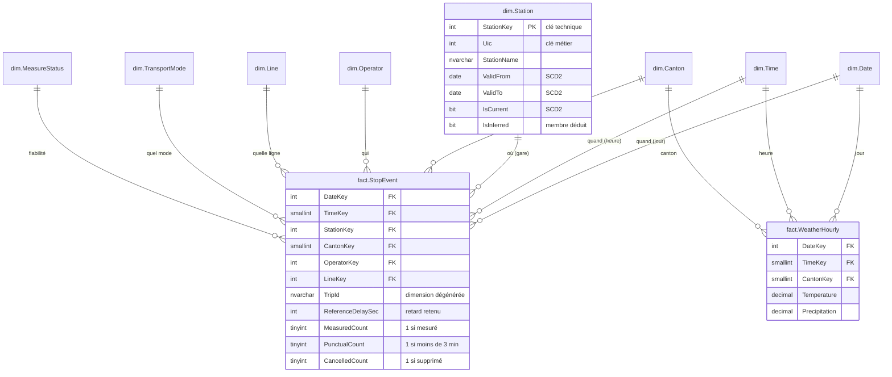

# 4. Modèle de données de l'entrepôt (CH_DWH)

## Le principe du « modèle en étoile »

Au centre, une **table de faits** : les événements que l'on veut compter ou mesurer (ici, *un train passe à une gare*). Autour, les **dimensions** : les axes par lesquels on veut analyser (*quand ? où ? qui ? quoi ?*). Dessiné, cela ressemble à une étoile.

## Grain des tables de faits

Le **grain** est ce que représente une ligne. C'est la première question à se poser en modélisation.

| Table | Une ligne = | Volume |
|---|---|---|
| `fact.StopEvent` | **Un trajet** qui passe à **un arrêt** un **jour** donné | ~2,5 M par jour |
| `fact.WeatherHourly` | La météo d'**une heure** dans **un canton** | 624 par jour (24 × 26) |

## Dictionnaire des dimensions

| Dimension | Clé | Contenu | Alimentation | Historisation |
|---|---|---|---|---|
| `dim.Date` | `DateKey` (AAAAMMJJ) | Calendrier 2020 à 2035, noms français, semaine ISO, **jours fériés suisses** (Pâques calculé) | Script `06` | Statique |
| `dim.Time` | `TimeKey` (HHMM) | 1 440 minutes, tranches horaires (pointe du matin, etc.) | Script `06` | Statique |
| `dim.Canton` | `CantonKey` (n° officiel OFS 1 à 26) | Nom, chef-lieu, région linguistique, coordonnées | Script `06` | Statique |
| `dim.TransportMode` | `TransportModeKey` | Traduction des codes allemands (`Zug` → Train) | Script `06` + nouveaux codes auto | Ajout seulement |
| `dim.MeasureStatus` | `StatusKey` | REAL, GESCHAETZT, PROGNOSE... | Script `06` | Statique |
| `dim.Operator` | `OperatorKey` | Opérateurs | `etl.usp_Load_DimOperator` | **SCD type 1** (écrasement) |
| `dim.Line` | `LineKey` | Lignes (opérateur + mode + code) | `etl.usp_Load_DimLine` | **SCD type 1** |
| `dim.Station` | `StationKey` | Gares et arrêts | `etl.usp_Load_DimStation` | **SCD type 2** (historique) |

### Ligne « Inconnu » (clé -1)

Chaque dimension contient une ligne de clé **-1**. Si un passage arrive avec un opérateur inconnu, il est rattaché à « Opérateur inconnu » au lieu d'être perdu. On ne perd jamais de faits, et la requête 6 de `99_Controles.sql` mesure combien de faits sont concernés.

### SCD type 2 sur les gares : exemple

La gare `8501120` change de nom le 15/11/2026 :

| StationKey | Uic | StationName | ValidFrom | ValidTo | IsCurrent |
|---|---|---|---|---|---|
| 1201 | 8501120 | Lausanne | 1900-01-01 | 2026-11-15 | 0 |
| 60412 | 8501120 | Lausanne-Gare | 2026-11-15 | 9999-12-31 | 1 |

- Les passages **avant** le 15/11 restent rattachés à la clé 1201 (« Lausanne »).
- Les passages **à partir** du 15/11 sont rattachés à la clé 60412.
- La détection du changement se fait par **empreinte** (`HashDiff` = SHA-256 des attributs suivis).

### Membres déduits (*inferred members*)

Un passage cite l'arrêt `8002140` (Augsburg, en Allemagne), absent du référentiel suisse. Plutôt que de rejeter le passage :
1. on crée l'arrêt dans `dim.Station` avec le nom lu dans le passage et `IsInferred = 1` ;
2. si un jour le référentiel le fournit, la ligne est **complétée sur place**.

## Règles de calcul des indicateurs

| Indicateur | Règle | Où |
|---|---|---|
| Retard d'arrivée | `AN_PROGNOSE - ANKUNFTSZEIT` en secondes | `stg.usp_Load_Istdaten` |
| **Retard de référence** | Retard d'arrivée s'il est mesuré, sinon de départ s'il est mesuré, sinon *vide*. Toujours vide pour un passage supprimé ou aberrant. | `etl.usp_Load_FactStopEvent` |
| Passage mesuré | Retard de référence non vide | `MeasuredCount` |
| **Passage ponctuel** | Mesuré **et** retard < 180 s (définition CFF : moins de 3 minutes) | `PunctualCount` |
| Taux de ponctualité | Σ ponctuels ÷ Σ mesurés | Mesure DAX du cube |
| Heure pluvieuse | Pluie ≥ 0,5 mm **ou** neige > 0 | `cube.vw_Meteo` |

## Couche de vues `cube.*`

Le cube ne lit jamais les tables directement mais des vues (`cube.vw_Passage`, `cube.vw_Gare`...). Avantages :
- on peut modifier une table sans casser le cube ;
- les vues exposent seulement les colonnes utiles (cube plus léger) ;
- certains calculs simples y sont faits une fois pour toutes (retard en minutes, clé horaire `HourKey` pour croiser avec la météo).
