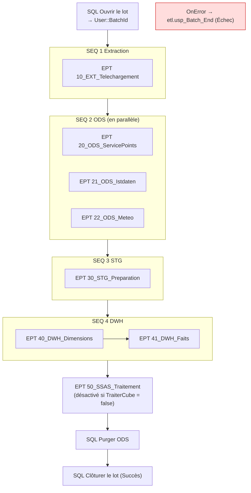

# 5. Le projet SSIS `DWH_Suisse_ETL`

## Contenu du projet

| Fichier | Rôle |
|---|---|
| `DWH_Suisse_ETL.dtproj` | Le projet à ouvrir dans Visual Studio |
| `Project.params` | **Paramètres du projet** (chemins, serveur, options) |
| `CM_ADMIN.conmgr`, `CM_ODS.conmgr`, `CM_STG.conmgr`, `CM_DWH.conmgr` | **Connexions partagées** par tous les packages (une par base) |
| `00_MASTER.dtsx` | **Master package** : orchestre tout |
| `10_` à `50_*.dtsx` | Packages enfants, un par étape |

## Convention de nommage

| Préfixe de package | Couche |
|---|---|
| `00_` | Master |
| `1x_` | Extraction (EXT) |
| `2x_` | ODS |
| `3x_` | STG |
| `4x_` | DWH |
| `5x_` | Cube |

| Préfixe de tâche | Type de tâche SSIS |
|---|---|
| `SQL` | Execute SQL Task |
| `EPT` | Execute Package Task / Execute Process Task |
| `DFT` | Data Flow Task |
| `FEL` | Foreach Loop Container |
| `SEQ` | Sequence Container |
| `FST` | File System Task |
| `FFS` | Flat File Source (dans un Data Flow) |
| `DER` | Derived Column (dans un Data Flow) |
| `CNT` | Row Count (dans un Data Flow) |
| `OLE_DST` | OLE DB Destination (dans un Data Flow) |

> Ces conventions sont un point de départ : elles seront alignées sur la page des bonnes pratiques de l'entreprise (phase 8).

## Paramètres du projet

Double-cliquez sur `Project.params` dans l'Explorateur de solutions.

| Paramètre | Défaut | Rôle |
|---|---|---|
| `ServerName` | `localhost` | Instance SQL Server. Toutes les connexions l'utilisent par **expression**. |
| `DataFolder` | `C:\DWH_Suisse\data` | Dossier des fichiers téléchargés |
| `ScriptsFolder` | `C:\DWH_Suisse\DWH-Suisse\scripts` | Dossier des scripts PowerShell du dépôt |
| `NbJoursIstdaten` | `3` | Nombre de jours de passages à récupérer (1 à 60) |
| `RetentionJoursODS` | `30` | Purge des données brutes déjà intégrées depuis N jours |
| `TraiterCube` | `false` | Passez à `true` après avoir déployé le cube |
| `ServeurSSAS` | `localhost` | Instance Analysis Services |
| `BaseSSAS` | `DWH_Suisse_Cube` | Nom du modèle déployé |

## Le master package `00_MASTER.dtsx`



Points clés à observer :
- **`BatchId`** : créé au début (procédure `etl.usp_Batch_Start`), il est transmis à chaque enfant par l'*Execute Package Task* (onglet *Parameter bindings*). Toutes les lignes chargées portent ce numéro.
- **Parallélisme** : les 3 packages ODS sont dans un même *Sequence Container*, sans contrainte entre eux, donc ils tournent en même temps.
- **Exécution conditionnelle** : la tâche du cube a une expression sur sa propriété `Disable` (`!@[$Project::TraiterCube]`). Une tâche désactivée est ignorée et la suite continue.
- **Gestion d'erreur** : l'onglet *Event Handlers* > `OnError` enregistre le message d'erreur et la tâche fautive dans `CH_ADMIN.etl.Batch`.

## Structure commune des packages enfants

Chaque enfant suit le même modèle :

```
SQL Début étape   →  [travail du package]  →  SQL Fin étape
        (etl.usp_Step_Start)                    (etl.usp_Step_End)
+ OnError : etl.usp_Step_End avec statut "Échec" et message d'erreur
```

Chaque enfant a un **paramètre de package** `BatchId` (0 par défaut), ce qui permet aussi de l'exécuter **seul** pour tester.

## Détail des packages

### `10_EXT_Telechargement` : extraction

Trois **Execute Process Tasks** lancent `powershell.exe` avec un script du dépôt. Les arguments sont construits par **expression** à partir des paramètres du projet, par exemple :

```
"-NoProfile -ExecutionPolicy Bypass -File \"" + @[$Project::ScriptsFolder] + "\\Get-Istdaten.ps1\" "
  + "-DataFolder \"" + @[$Project::DataFolder] + "\"" + " -NbJours " + (DT_WSTR,5)@[$Project::NbJoursIstdaten]
```

Si un script échoue, il renvoie un code de sortie 1 et la tâche passe en erreur. Le détail est dans `C:\DWH_Suisse\data\logs\`.

### `20_ODS_ServicePoints` : premier Data Flow

`SQL Vider ods ServicePoint` (TRUNCATE) puis `DFT Charger ods ServicePoint` :

```
FFS Fichier source  →  DER Colonnes audit  →  CNT Lignes  →  OLE_DST [ods].[ServicePoint]
(fichier plat, 55     (ajoute _BatchId et     (compte les     (chargement rapide,
 colonnes texte)       _SourceFile)             lignes)         TABLOCK)
```

- La **connexion fichier plat** `FF ServicePoints` a une expression sur `ConnectionString` : `@[$Project::DataFolder] + "\\servicepoints\\service-points.csv"`.
- Page de code **65001 (UTF-8)**, séparateur `;`, fin de ligne LF, en-tête en première ligne.
- Le nombre de lignes (`User::RowCount`) est enregistré dans le journal en fin de package.

### `21_ODS_Istdaten` : boucle sur fichiers

```
SQL Début étape
  └─ FEL Fichiers Istdaten   (Foreach File Enumerator : *_istdaten.csv)
        SQL Préparer fichier      → supprime les lignes déjà chargées de ce fichier (reprise)
        DFT Charger ods Istdaten  → même schéma de Data Flow, 22 colonnes
        SQL Enregistrer fichier   → etl.FileLog (statut ODS_OK, nb de lignes)
        FST Archiver fichier      → déplace le fichier vers archive\istdaten
SQL Fin étape (total des fichiers du lot)
```

Variables à observer :
- `User::FilePath` : alimentée à chaque tour par la boucle (onglet *Variable Mappings*)
- `User::FileName` : **expression** `TOKEN(@[User::FilePath], "\\", TOKENCOUNT(@[User::FilePath], "\\"))`, soit le nom du fichier sans le chemin
- `User::ArchiveFolder` : expression construite à partir de `DataFolder`

La connexion `FF Istdaten` prend `@[User::FilePath]` comme chemin : **un seul Data Flow traite tous les fichiers**.

### `22_ODS_Meteo` : JSON sans composant payant

Boucle sur `meteo_*.json`. Chaque fichier est lu **par SQL Server** (`ods.usp_Load_MeteoJson`, qui utilise `OPENROWSET(BULK ..., SINGLE_NCLOB)`) et stocké tel quel. Le JSON sera déplié en STG avec `OPENJSON`.

### `30_STG_Preparation`

Les 3 procédures `stg.usp_Load_*` en parallèle : typage, règles de qualité, rejets, calcul des retards, dépliage du JSON météo.

### `40_DWH_Dimensions`

1. En parallèle : `etl.usp_Load_DimOperator`, `etl.usp_Load_DimTransportMode`, `etl.usp_Load_DimLine` (SCD1)
2. Puis `etl.usp_Load_DimStation` (SCD2)
3. Puis `etl.usp_Load_DimStation_Inferred` (membres déduits)

L'ordre compte : les arrêts déduits ne doivent être créés qu'après la mise à jour du référentiel.

### `41_DWH_Faits`

`etl.usp_Load_FactStopEvent` et `etl.usp_Load_FactWeatherHourly` en parallèle (« supprimer puis insérer » par jour). En cas de succès, les fichiers passent en statut `DWH_OK`.

### `50_SSAS_Traitement`

Execute Process Task → `Invoke-ProcessCube.ps1` (commande TMSL *refresh full*).

## Exécuter un package seul

Clic droit sur le package > *Execute Package*. Le `BatchId` vaudra 0. Pour rattacher l'exécution à un vrai lot, ouvrez le package, onglet *Parameters*, et saisissez un `BatchId` existant dans `CH_ADMIN.etl.Batch`.

## Comment ces packages ont été produits

Les fichiers `.dtsx` ont été générés par `tools/generate_ssis.py` (XML produit par programme, noms et identifiants homogènes). **Une fois le projet ouvert dans Visual Studio, c'est Visual Studio qui fait foi** : modifiez les packages dans le concepteur et ne relancez plus le générateur, sinon vos modifications seront écrasées.
